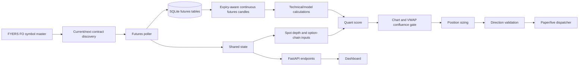
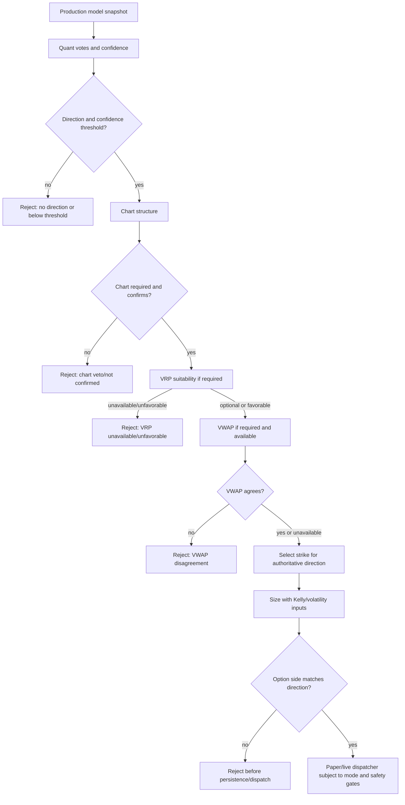

# Model Integration And Verdict Flow

Audit date: 2026-10-18  
Repository branch: `main`  
Status: verified implementation with market-closed limitations

This document describes the active source code, not the YAML registry alone and not
historical design intent. A model being displayed by `/models/live/NIFTY50` does not
mean it contributes to the directional score.

## Architecture

Startup in `api/main.py:on_startup` initializes SQLite, starts background pollers,
position monitoring, and the auto-entry loop. The futures starter is idempotent in
`engine/background/pollers.py:start_futures_depth_poller`.

## Instrument And Data Lineage

| Consumer | Intended source | Actual source and fields | Status / evidence |
|---|---|---|---|
| Current futures contract | NIFTY futures | FYERS `symTicker`, `expiryDate`, `minLotSize`, `tickSize` | Correct. `ofi.py:discover_nifty_monthly_futures` sorts unexpired monthly symbols by authoritative expiry. |
| Next futures contract | NIFTY futures | Same symbol-master fields, separate `next_month` role | Correct and isolated. Rollover test covers nearest two expiry dates. |
| Futures quote | Selected futures contract | `quotes()` response mapped by exact symbol; LTP, changes, OHLC, quote timestamp | Correct structurally; live values unavailable after hours. |
| Futures candles | Selected futures contract | `history()` with resolution `1`, `cont_flag=0`; OHLCV and provenance retained | Correct structurally; provider/live freshness is not currently verifiable after hours. |
| Continuous futures candles | NIFTY futures | Raw contract rows selected by expiry and back-adjusted only in returned series | Correct, explicit transformation. Raw rows remain contract-specific. |
| Futures depth / OFI | NIFTY futures | Depth keyed by exact contract symbol; current and next remain separate | Directional score input only when both discovered contracts are fresh and valid. |
| NIFTY technical models and VWAP | NIFTY futures in this application | `_get_analysis_candles("NIFTY50")` reads `get_continuous_futures_candles`; VWAP uses those candles' real volume | Correct source wiring. Missing/zero volume is excluded, never fabricated. |
| Spot OFI | NIFTY 50 spot | `NSE:NIFTY50-INDEX` depth through shared state | Intentionally spot-based and remains separate from futures OFI. |
| Options, PCR, max pain, OI, GEX, IV | Options chain / spot reference | FYERS option-chain shared state and its provider symbols | Intentionally options-based; no futures substitution. |
| VIX regime | India VIX spot | `NSE:INDIAVIX-INDEX` quote/candle path | Intentionally separate instrument. |
| Correlation breakdown | Multiple approved index series | Only NIFTY series exists | Disabled / not applicable, correctly not fabricated. |
| Dashboard futures chart | NIFTY futures | `/candles/NIFTY50` and `/market/futures`; source/provenance displayed | Correct labels; live quote is null when market is closed. |
| Historical backfill | NIFTY futures | `scripts/backfill_nifty_futures.py` uses discovered current/next symbols | Structurally correct; prior FYERS `-99 Bad request` blocked provider verification. |

### Contract handling

The selector rejects malformed, expired, non-monthly, non-NIFTY, duplicate, and
non-futures symbols. Current and next roles are assigned after sorting by expiry.
Poller data, SQLite writes, shared state, and depth calculations retain the exact
contract symbol and expiry. There is no silent spot-to-futures fallback in the
active technical candle path. Continuous candles use an explicit additive
back-adjustment at contract changes; this is a display/calculation transformation,
not a rewrite of stored raw data.

### Persistence

`futures_quotes`, `futures_candles`, and `futures_depth_snapshots` are additive
SQLite tables. Writes are symbol/role/timestamp aware and candle writes are
deduplicated by `(symbol, minute_bucket)`. The live database passed the pre-edit
SQLite backup integrity check; no database rows were deleted or reset.

## Model Catalogue And Roles

| Group | Model(s) | Input source | Actual role | Score weight |
|---|---|---|---|---|
| A | Realized volatility, GARCH(1,1) | Continuous futures candles | Context / monitoring; no directional vote | None |
| B | VRP, IV Rank | Option-chain ATM IV and continuous-futures GARCH forecast | VRP premium-suitability result; optional gate, never directional | No directional weight |
| C | Hurst | Continuous futures candles | Regime context selecting z-score semantics | None; Hurst never votes |
| C | Z-score | Continuous futures candles | Directional contributor | Dynamic, max `0.8` mean-reverting or `0.6` trending |
| C | Variance ratio | Continuous futures candles, `q=5` | Confirmation of Hurst regime; disagreement withholds z-score | None; no independent vote |
| C | Spot OFI | NIFTY 50 spot depth | Directional contributor when valid | `min(abs(ofi)*2, 1.0) * 0.7` |
| C | NIFTY futures OFI | Current/next futures depth | Directional contributor from complete aggregate | `min(abs(combined_ofi)*2, 1) * 0.7` |
| D | PCR | Options chain | Contrarian directional contributor | Up to `0.4`, continuous outside `0.7..1.3` |
| D | Max pain | Options chain plus spot reference | Soft directional contributor | Up to `0.3` |
| D | OI change | Options chain | Directional positioning contributor | Up to `0.35` |
| D | GEX | Options chain | Diagnostic-only | None |
| E | VIX regime, RV/IV ratio | VIX/continuous candles/IV | Context-only | None |
| E | Correlation breakdown | Multiple index returns | Disabled/not applicable | None |
| F | Fractional Kelly, volatility-scaled sizing | Trade history and volatility | Sizing-only, separate from direction | Not in score |
| G | GBT classifier | Logged confluence feature vector and linked outcomes | Conditional score contributor | Up to `0.5`, discounted to `0.25` when validation does not beat baseline |

The active production evaluation builds `model_outputs` in
`api/main.py:confluence_signal`. It includes Hurst, z-score, Variance Ratio, spot
OFI, futures OFI, PCR, max pain, OI change, VRP, spot reference, and Group G.
Other models may be computed by the dashboard inventory endpoint, but their absence
from the production snapshot remains intentional when their role is context,
sizing, disabled, or not part of that decision call.

### Four-model integration rules

- Hurst thresholds are unchanged: `H > 0.55` is trending, `H < 0.45` is
  mean-reverting, and `0.45 <= H <= 0.55` is random-walk/ambiguous. Hurst only
  selects the Z-score interpretation.
- Variance Ratio uses the existing `q=5` calculation. `VR > 1.1` is persistent,
  `VR < 0.9` is mean-reverting, and the band between them is ambiguous. When both
  Hurst and Variance Ratio are valid but disagree, the Z-score vote is withheld.
  Hurst and Variance Ratio are therefore not counted twice.
- VRP remains `ATM IV percentage - annualized GARCH forecast percentage`. The
  existing suitability threshold is `VRP <= 2.0` percentage points. It is exposed
  in the snapshot and can veto only when `require_vrp=true`; the default remains
  false because incremental walk-forward validation is not available.
- Futures OFI uses the existing normalized formula
  `(total_buy_qty-total_sell_qty)/(total_buy_qty+total_sell_qty)`. The existing
  quantity-weighted aggregate of both discovered contracts is required. A complete
  `status=valid` result receives the existing comparable OFI weight `0.7`; stale,
  partial, missing, invalid, or API-error results receive no vote.

## Score And Confidence

For each eligible model, the implementation produces a direction `d` in
`{-1, 0, +1}` and a non-negative dynamic weight `w`. The directional aggregate is:

`weighted_direction = sum(d_i * w_i) / sum(w_i)`

Direction is `long_call` when the result is positive, `long_put` when negative,
and neutral (`None`) when no usable vote exists. The denominator is the sum of
actual eligible vote weights. Missing, unavailable, invalid, diagnostic-only,
context-only, sizing-only, and disabled outputs do not receive a vote.

Current confidence implementation:

`avg_weight = total_weight / number_of_vote_entries` (computed for diagnostics)

`max_possible_weight = max(actual vote weight)`

`agreement_bonus = min(number_of_positive_weight_votes / 3, 1) * 0.15`

`confidence = min(max_possible_weight / 0.8 + agreement_bonus, 1.0)`

The confidence formula is based on strongest vote strength and vote count; it does
not measure the magnitude of opposing votes. This is current behavior and is not
changed by this audit because changing it would alter strategy behavior.

There are no configured group weights or fixed group-normalization denominators in
the active implementation. The effective weights are model-specific and dynamic.
No runtime override for score weights was found. The YAML registry is descriptive
and is not loaded as the production score authority.

### Weight reference

| Model | Formula / maximum | Active? | Evidence |
|---|---|---|---|
| Z-score | `min(abs(z)/2,1) * 0.8` mean-reverting; `*0.6` trending | Yes when Hurst regime and z-score exist | `quant_score.py:_vote_from_zscore` |
| Spot OFI | `min(abs(ofi)*2,1) * 0.7` | Yes when valid | `_vote_from_ofi` |
| PCR | `min(distance/0.6,1) * 0.4` outside thresholds | Yes when outside neutral band | `_vote_from_pcr` |
| Max pain | `min(distance_pct/1.0,1) * 0.3` | Yes when valid and not pinned | `_vote_from_max_pain` |
| OI change | `min(oi_change/10,000,000,1) * 0.35` | Yes for valid top build | `_vote_from_oi_change` |
| Group G | `min(abs(score-0.5)*2,1) * 0.5`; half if baseline not beaten | Conditional | `_vote_from_group_g` |
| Futures OFI | `min(abs(combined_ofi)*2,1) * 0.7`; requires both contracts valid | Yes when fresh | `_vote_from_futures_ofi` |
| Group weights | None implemented | No | No group-weight lookup in active score path |

## Verdict Flow

The saved NIFTY default confidence threshold is `0.95`; `require_chart_confirmation`
and `require_vwap` default true. `require_vrp` defaults false pending validation,
and `vrp_buy_threshold_pct` is `2.0`. The gate preserves only the quant direction.
Neutral or missing direction is non-tradable. VWAP missing data is currently
skipped by `evaluate_confluence`, while invalid/mismatching VWAP is not silently
converted to a signal. This is existing behavior and is documented rather than
changed.

Sizing is separate: NIFTY lot size is `65`; risk amount is capital multiplied by
`risk_per_trade_pct`, then optional Kelly and volatility multipliers are applied.
Hard stop, time stop, trailing stop, entry gates, and execution mode remain in
their existing paths and were not changed.

## Snapshot Provenance

The production confluence evaluation receives an ID before model aggregation and
keeps it in the in-process `_LAST_CONFLUENCE_EVALUATION`. This audit also persists
the same ID in `model_scores.evaluation_id`, added with an additive migration. The
feature vector, fired/rejected state, direction, veto, confidence, and evaluation
ID can therefore be joined after restart. Existing rows retain NULL because their
historical evaluation ID was never persisted and cannot be fabricated.

## Reproducible Runtime Evidence

The latest available runtime evidence is the read-only `/models/live/NIFTY50`
response at approximately `2026-10-18 12:14 IST`:

- Production evaluation ID: `2026-10-18T12:14:26.895664+05:30`.
- Current discovered contracts: `NSE:NIFTY26OCTFUT` and `NSE:NIFTY26NOVFUT`.
- Market status: `market_closed`; current and next quotes/depth were unavailable.
- Futures OFI: `0/2` valid, `diagnostic_only=true`, `trading_integration=false`.
- Quant votes: z-score direction `+1`, weight `0.8`; Group G direction `-1`, weight `0.0803`.
- Quant direction: `long_call`; confidence `1.0` under the current formula.
- Chart result: `opposite`; final gate: `fired=false`, veto `chart_veto_opposite_structure`.
- Hurst and Variance Ratio were not present in that historical snapshot's logged
  production model output, so no retroactive confirmation effect is claimed.
- VRP was unavailable because the option chain was unavailable.
- Group G was active with score `0.3394`, validation accuracy `0.619`, and
  `model_beats_baseline=false`; its contribution was discounted, not promoted.

The example is not a trade execution. It is a rejected signal evaluation. No live
order was sent by this audit.

## APIs, UI, And Configuration

Relevant endpoints are `/market/futures`, `/candles/NIFTY50`,
`/signals/ofi/NIFTY50/futures`, `/signals/confluence/NIFTY50`, and
`/models/live/NIFTY50`. The frontend chart consumes futures candles and current
futures quote data; model health consumes `/models/live/NIFTY50`.

The active configuration is in `config/trading_config.py`, with persisted values
loaded from `app_settings`. `config/model_registry.yaml` lists intended modules but
is not the runtime scoring loader. The UI has placeholder tabs for backtest model
history and trade log; those are not evidence of active consumers.

## Tests And Evidence

Focused verification passed after the four-model integration change:

`python -m pytest tests/unit/test_four_model_integration.py tests/unit/test_model_integration_runtime.py tests/unit/test_quant_integration.py tests/unit/test_confluence_gate.py tests/unit/test_futures_pipeline.py -q`

Result: `34 passed`, with existing deprecation warnings only. The additional
regression group containing sizing, stops, trailing stops, time display,
correlation, and snapshot provenance passed `14 tests`.

`python -m py_compile` passed for changed backend Python files. `git diff --check`
passed with expected line-ending warnings. Frontend build remains unverified because
the repository does not contain `frontend/node_modules`.

## Limitations And Pending Work

| Priority | Pending item | Reason / evidence needed | Safe next action |
|---|---|---|---|
| High | Live futures quote/candle/volume/depth freshness | Current session is market-closed; earlier provider calls returned FYERS `-99 Bad request` | During an approved market session, run read-only requests and verify persisted rows by exact symbol. |
| High | Diagnose FYERS `-99` market-data responses | Authentication/profile success does not prove market-data authorization or request validity | Inspect provider response/request contract with approved credentials, without changing TLS/auth handling. |
| Medium | Validate futures VWAP/volume in live session | No current live futures volume/depth evidence | Verify positive-volume futures history and explicit VWAP source before relying on it. |
| Medium | Validate futures OFI quality | Endpoint currently has no valid snapshots after hours | Verify both contracts' timestamps and quantities; confirm the configured score path with live evidence. |
| Medium | Validate futures OFI incremental score weight | The `0.7` value reuses the existing spot-OFI weight but has no futures-specific walk-forward result | Compare baseline and futures-OFI variants on synchronized futures-depth/outcome data before changing the weight. |
| Medium | Validate VRP suitability threshold | Existing formula uses `2.0` percentage points, but incremental trade-quality validation is unavailable | Run time-ordered option-chain, IV, GARCH, premium, and outcome analysis before enabling `require_vrp`. |
| Medium | Validate model freshness during market hours | Current candles and options/depth are unavailable or stale outside session | Repeat `/models/live` and compare evaluation ID, source timestamps, and snapshot membership. |
| Medium | Review confidence calibration | Current formula can remain high with opposing votes | Requires explicit strategy approval and historical validation; no change made. |
| Low | Runtime-load the YAML model registry | Registry is descriptive, not authoritative | Requires design approval because it could alter eligibility and runtime behavior. |
| Low | Complete placeholder frontend tabs | Backtest/model-history and trade-log UI consumers are incomplete | Define API/UI scope before implementing; no trading path depends on them. |

## Safety Confirmation

This audit did not change sizing/risk limits, stops, entry/exit behavior,
execution safeguards, credentials, authentication, or live-trading/auto-entry
settings. It did authorize and implement the four model integrations described
above. The futures OFI score weight reuses the existing spot-OFI normalization
and weight but remains pending futures-specific walk-forward validation. VRP
gating remains opt-in. Tests and documentation were updated.
